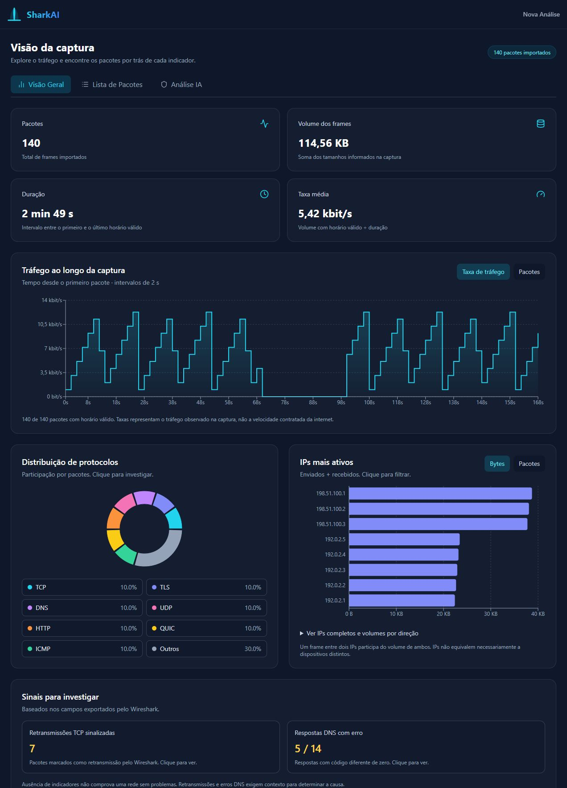
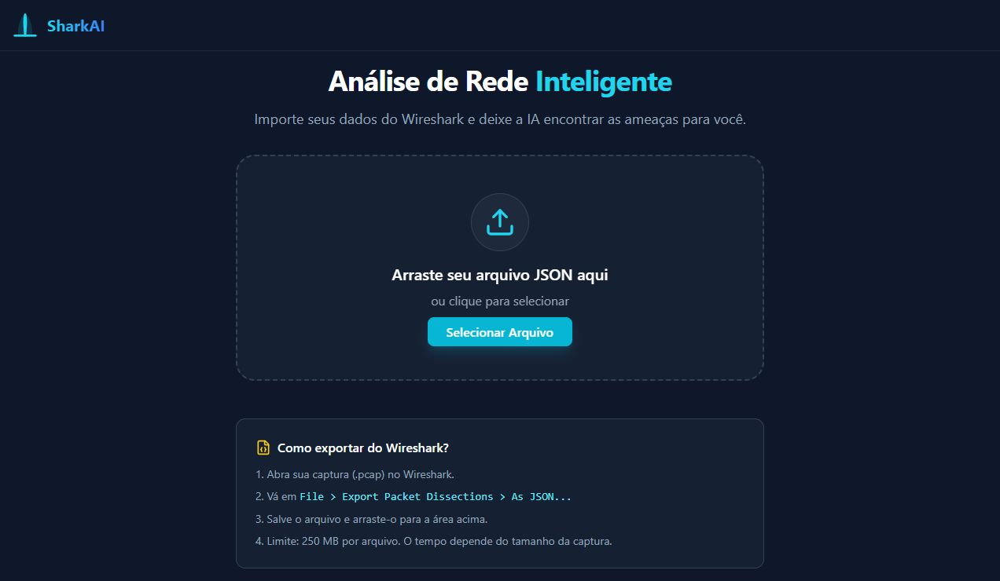
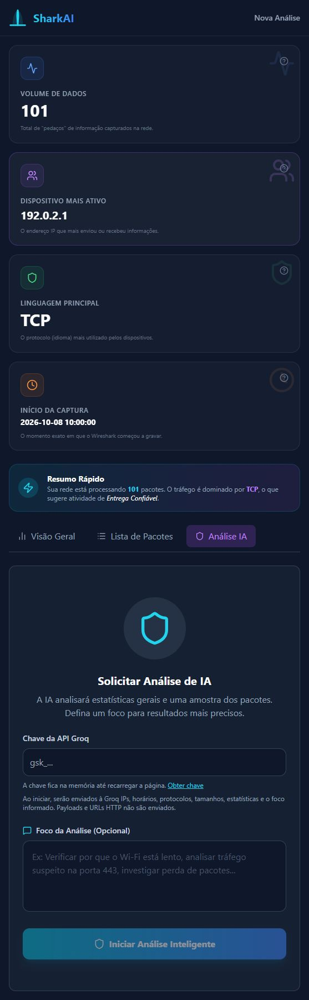

# SharkAI

Analisa capturas do **Wireshark** no navegador: protocolos, IPs, linha do tempo, retransmissões e erros de DNS. Também gera um relatório em linguagem simples com IA.



## Sobre

Abrir uma captura grande no Wireshark e descobrir o que está errado exige experiência: filtrar protocolos, seguir conversas, achar retransmissões. O SharkAI importa a captura exportada em JSON, organiza tudo num painel com gráficos e filtros e, quando você pede, usa IA para explicar o que está acontecendo na rede e onde investigar.

## Funcionalidades

- **Importação de capturas JSON** de até 250 MB, processadas em segundo plano (Web Worker), com opção de cancelar
- **Painel da captura**: volume, duração, taxa média, principais protocolos e IPs
- **Lista de pacotes** com busca e paginação. Clique num protocolo, IP ou indicador para filtrar
- **Linha do tempo** com escala de horário única (epoch, relativo ou texto)
- **Indicadores de problema**: retransmissões TCP e erros de DNS
- Suporte a IPv4, IPv6 e Ethernet
- **Análise com IA** via Groq (`openai/gpt-oss-120b`), com um foco opcional informado por você

## Telas

<table>
<tr><td width="60%" align="center"><br /><sub>Importação do JSON exportado pelo Wireshark</sub></td><td width="40%" align="center"><br /><sub>Análise com IA</sub></td></tr>
</table>

## Requisitos

- Node.js 22+ (os testes usam `--experimental-strip-types`)
- Uma chave do [Groq](https://console.groq.com/keys) (opcional), só para a análise com IA

## Como rodar

```bash
npm install
npm run dev
```

Abra http://localhost:3000. Para produção: `npm run build && npm run preview`.

Para validar: `npm run lint`, `npm test` e `npm run build`.

### Exportando a captura

No Wireshark: **File → Export Packet Dissections → As JSON**. Arquivos PCAP precisam ser exportados assim antes de importar.

## Privacidade

A importação, os gráficos e os filtros rodam no seu navegador. A chave do Groq fica só na memória da página: não vai para o build, não é salva no navegador e some ao recarregar. Quando você pede a análise com IA, o SharkAI envia ao Groq um resumo da captura: estatísticas, IPs, horários, protocolos e uma amostra de até 30 pacotes. Não use a análise com IA em capturas com dados que não podem sair da sua rede.

> A interface carrega o Tailwind CSS por CDN, então precisa de internet para aparecer estilizada.

## Autor

Criado por **Guilherme Dill** · [RUNE Projects](https://www.runeprojects.com.br) · [GitHub](https://github.com/guilhermealceu)

## Licença

[MIT](LICENSE)

<sub>Wireshark é marca registrada da Wireshark Foundation. Este projeto é independente e não tem vínculo com o Wireshark.</sub>
